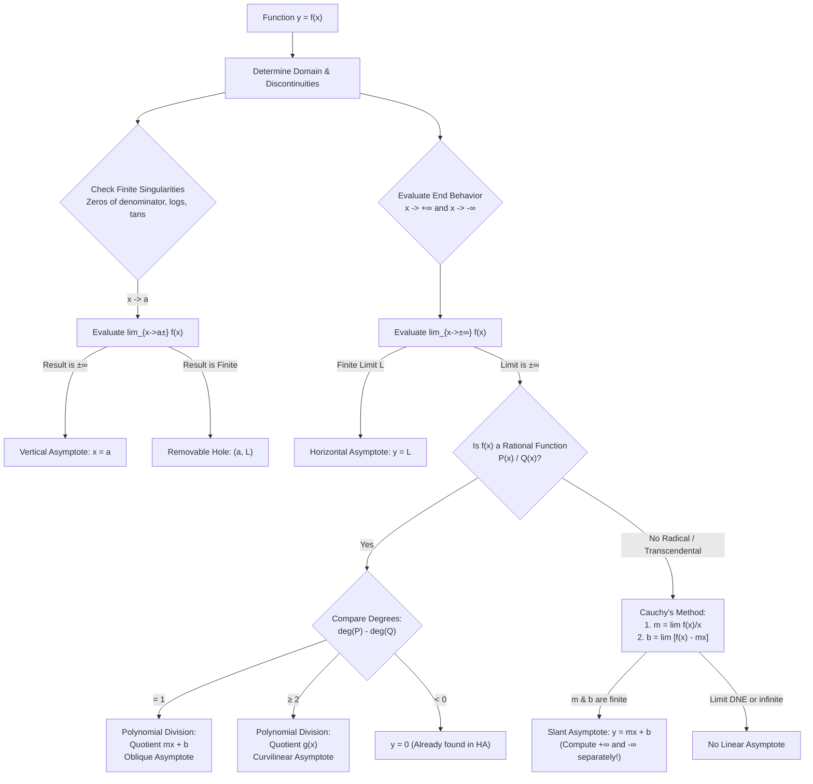

::: {.callout-note}
### Preprint / Mathematical Analysis & Calculus Foundations
This monograph provides a rigorous treatment of asymptotic behavior for real-valued functions. Moving beyond elementary calculus heuristics, we formulate asymptotes through point-to-set Euclidean distance in the plane, contrast algebraic polynomial long division with Cauchy's universal limit methodology, derive direction-dependent slant asymptotes for radical and transcendental curves, rigorously dismantle the widespread pedagogical misconception that curves cannot intersect their asymptotes, and generalize the concept to higher-degree curvilinear asymptotic envelopes.
:::

---

## 1. Introduction: What is an Asymptote?

The word *asymptote* derives from the Greek $\alpha\sigma\acute{\upsilon}\mu\pi\tau\omega\tau\text{o}\varsigma$ (*asymptotos*), compounded from $\alpha$- ("not"), $\sigma\acute{\upsilon}\nu$ ("with" or "together"), and $\pi\tau\omega\tau\acute{o}\varsigma$ ("falling"). Literally meaning *"not falling together"* or *"not meeting"*, the term was introduced into mathematical literature by Apollonius of Perga in his classical treatise *Conics* (c. 200 BCE) when studying the rectilinear envelopes bounding hyperbolic sections.

In elementary algebra and precalculus, an asymptote is frequently taught through an imprecise and misleading operational slogan: *"a straight line that a curve gets closer and closer to, but never touches or crosses."* As every analysis student quickly learns, this statement is **doubly flawed**:
1. Curves **can and frequently do** intersect their asymptotes—not only at isolated points, but infinitely many times (as seen in damped oscillations).
2. Asymptotes need **not be straight lines**; they can be parabolas, cubics, or transcendental curves that capture the dominant growth envelope of a function.

### Rigorous Metric Definition in the Real Plane

Let $C \subset \mathbb{R}^2$ be the planar curve defined by the graph of a continuous or piecewise continuous function $y = f(x)$, and let $A \subset \mathbb{R}^2$ be another curve (often a line $y = g(x)$). 

For any point $P = (x, f(x)) \in C$, let $d(P, A)$ denote the minimum Euclidean distance from $P$ to the set $A$:
$$\begin{aligned}
d(P, A) &= \inf_{Q \in A} \|P - Q\|_2 = \inf_{(u, v) \in A} \sqrt{(x - u)^2 + (f(x) - v)^2}
\end{aligned}$$

::: {.callout-tip}
### Definition: Asymptotic Curve
The curve $A$ is an **asymptote** to the graph of $f(x)$ as $x \to +\infty$ (respectively $x \to -\infty$) if and only if:
$$\lim_{x \to +\infty} d((x, f(x)), A) = 0 \quad \left(\text{or } \lim_{x \to -\infty} d((x, f(x)), A) = 0\right)$$
Similarly, a vertical line $x = a$ is an asymptote if $d((x, f(x)), \{(a, y) : y \in \mathbb{R}\}) \to 0$ as $|f(x)| \to \infty$.
:::

For rectilinear non-vertical asymptotes $L: y = mx + b$, the perpendicular distance from $(x, f(x))$ to the line $mx - y + b = 0$ is given by the standard geometric formula:
$$\begin{aligned}
d((x, f(x)), L) &= \frac{|f(x) - (mx + b)|}{\sqrt{1 + m^2}}
\end{aligned}$$

Because the denominator $\sqrt{1 + m^2}$ is a positive, non-zero constant, the metric condition $d((x, f(x)), L) \to 0$ is **strictly equivalent** to the vertical deviation condition:
$$\lim_{x \to \pm\infty} \big|f(x) - (mx + b)\big| = 0$$

This establishes the formal calculus definition used throughout mathematical analysis.

---

## 2. Taxonomy of Asymptotes

Single-variable functions exhibit three classical linear asymptotic behaviors, categorized by the orientation of the bounding line:

```
                          ┌───────────────────────────┐
                          │   Planar Asymptotes       │
                          └─────────────┬─────────────┘
                                        │
         ┌──────────────────────────────┼──────────────────────────────┐
         ▼                              ▼                              ▼
┌─────────────────┐            ┌─────────────────┐            ┌─────────────────┐
│ Vertical        │            │ Horizontal      │            │ Oblique (Slant) │
│ x = a           │            │ y = L           │            │ y = mx + b      │
│ |f(x)| -> inf   │            │ lim f(x) = L    │            │ m ≠ 0           │
│ Local Singular  │            │ End-Behavior    │            │ End-Behavior    │
└─────────────────┘            └─────────────────┘            └─────────────────┘
```

### 2.1 Vertical Asymptotes: Local Singularities

A line $x = a$ is a **vertical asymptote** of $y = f(x)$ if the function values explode to positive or negative infinity as $x$ approaches $a$ from either the left or the right:

$$\lim_{x \to a^-} f(x) = \pm\infty \quad \text{or} \quad \lim_{x \to a^+} f(x) = \pm\infty$$

Key features of vertical asymptotes:
- **Local Behavior**: Unlike horizontal and slant asymptotes, vertical asymptotes occur at finite coordinate locations $x = a \in \mathbb{R}$. They correspond to essential singularities or poles.
- **Crossing Rule**: By the definition of a single-valued function (the vertical line test), the graph of $f(x)$ **cannot cross** its vertical asymptote at any point where the function is defined. If $x = a$ is a vertical asymptote, $a$ is never in the interior domain of continuity for $f$.
- **Rational Functions**: For $f(x) = \frac{P(x)}{Q(x)}$ in irreducible form ($\gcd(P, Q) = 1$), vertical asymptotes occur at precisely the real roots of the denominator, $Q(a) = 0$.
- **Removable Discontinuities vs. Asymptotes**: If $P(a) = 0$ and $Q(a) = 0$, one must evaluate the limit:
  $$\lim_{x \to a} \frac{P(x)}{Q(x)}$$
  If the limit exists and is finite (e.g., $f(x) = \frac{x^2 - 1}{x - 1} \to 2$ as $x \to 1$), the point $(1, 2)$ is a *removable discontinuity* (a "hole"), not a vertical asymptote. A vertical asymptote requires the multiplicity of the root in $Q(x)$ to strictly exceed its multiplicity in $P(x)$.

### 2.2 Horizontal Asymptotes: Constant End-Behavior

A horizontal line $y = L$ is a **horizontal asymptote** of $y = f(x)$ if:
$$\lim_{x \to +\infty} f(x) = L \quad \text{or} \quad \lim_{x \to -\infty} f(x) = L$$

Key features:
- A function may have **at most two** distinct horizontal asymptotes (one as $x \to +\infty$, one as $x \to -\infty$).
- Classical examples with two distinct horizontal asymptotes include:
  $$f(x) = \arctan(x) \implies \lim_{x \to +\infty} \arctan(x) = \frac{\pi}{2}, \quad \lim_{x \to -\infty} \arctan(x) = -\frac{\pi}{2}$$
  $$g(x) = \frac{1}{1 + e^{-x}} \quad (\text{Logistic}) \implies \lim_{x \to +\infty} g(x) = 1, \quad \lim_{x \to -\infty} g(x) = 0$$
  $$h(x) = \frac{x}{\sqrt{x^2 + 1}} \implies \lim_{x \to +\infty} h(x) = 1, \quad \lim_{x \to -\infty} h(x) = -1$$

### 2.3 Oblique (Slant) Asymptotes: Linear Growth Envelopes

A straight line $y = mx + b$ with non-zero slope $m \neq 0$ is an **oblique (or slant) asymptote** of $y = f(x)$ if:
$$\lim_{x \to +\infty} \big[f(x) - (mx + b)\big] = 0 \quad \text{or} \quad \lim_{x \to -\infty} \big[f(x) - (mx + b)\big] = 0$$

When $m = 0$, this definition reduces exactly to that of a horizontal asymptote. Thus, horizontal and oblique asymptotes are unified as the affine linear cases of general asymptotic curves.

---

## 3. Techniques for Finding Oblique Asymptotes

Finding an oblique asymptote requires determining two constants: the slope $m \in \mathbb{R} \setminus \{0\}$ and the $y$-intercept $b \in \mathbb{R}$. Two primary analytical methods exist.

### 3.1 Method 1: Polynomial Long Division (Rational Functions)

For rational functions $f(x) = \frac{P(x)}{Q(x)}$ where $P$ and $Q$ are real polynomials, an oblique asymptote exists **if and only if** the degree of the numerator is exactly one greater than the degree of the denominator:
$$\deg(P) = \deg(Q) + 1$$

By the polynomial division algorithm with remainder:
$$\begin{aligned}
\frac{P(x)}{Q(x)} &= (mx + b) + \frac{R(x)}{Q(x)}
\end{aligned}$$
where the quotient is the linear polynomial $mx + b$ and the remainder polynomial satisfies $\deg(R) < \deg(Q)$.

Taking the limit as $x \to \pm\infty$:
$$\begin{aligned}
\lim_{x \to \pm\infty} \big[f(x) - (mx + b)\big] &= \lim_{x \to \pm\infty} \frac{R(x)}{Q(x)} = 0
\end{aligned}$$
because $\deg(R) \le \deg(Q) - 1$, meaning the denominator grows strictly faster than the numerator.

#### Worked Example 1: Rational Slant Asymptote

Consider the rational function:
$$f(x) = \frac{x^2 - 3}{x - 1}$$

1. **Check Degrees**: $\deg(P) = 2$, $\deg(Q) = 1$. The difference is $2 - 1 = 1$. A slant asymptote is guaranteed.
2. **Perform Long Division**:
   Divide $x^2 - 3$ by $x - 1$:
   $$\begin{aligned}
   x^2 - 3 &= x(x - 1) + (x - 3) \\
           &= x(x - 1) + 1(x - 1) - 2 \\
           &= (x + 1)(x - 1) - 2
   \end{aligned}$$
   Dividing through by $x - 1$:
   $$f(x) = (x + 1) - \frac{2}{x - 1}$$
3. **Isolate Quotient**:
   As $x \to \pm\infty$, $\frac{2}{x - 1} \to 0$.
   Therefore, the slant asymptote is:
   $$\boxed{y = x + 1}$$
4. **Vertical Asymptote**:
   Setting the denominator $x - 1 = 0$ gives a vertical asymptote at $\boxed{x = 1}$.

---

### 3.2 Method 2: Cauchy's Universal Limit Method

While polynomial long division is efficient for rational functions, it fails completely for non-polynomial expressions: square roots, logarithms, exponentials, or trigonometric functions. 

The universal, rigorous approach applicable to any differentiable or continuous function is **Cauchy's limit method**.

::: {.callout-important}
### Theorem: Cauchy's Asymptotic Line Theorem
A line $y = mx + b$ is an asymptote to $y = f(x)$ as $x \to +\infty$ if and only if both of the following limits exist as finite real numbers:

1. **Slope $m$**:
   $$m = \lim_{x \to +\infty} \frac{f(x)}{x}$$
2. **$y$-Intercept $b$**:
   $$b = \lim_{x \to +\infty} \big[f(x) - mx\big]$$

*(Identical formulations apply for $x \to -\infty$ using limits towards $-\infty$.)*
:::

#### Proof of the Theorem

**Direction 1 ($\implies$)**: Assume $y = mx + b$ is an asymptote. Then by definition:
$$\lim_{x \to +\infty} \big[f(x) - (mx + b)\big] = 0$$

Divide this expression by $x$ (for $x > 0$):
$$\begin{aligned}
\lim_{x \to +\infty} \frac{f(x) - (mx + b)}{x} &= 0 \\
\lim_{x \to +\infty} \left(\frac{f(x)}{x} - m - \frac{b}{x}\right) &= 0
\end{aligned}$$

Since $\lim_{x \to +\infty} \frac{b}{x} = 0$, by limit laws:
$$\lim_{x \to +\infty} \frac{f(x)}{x} = m$$

Having established $m$, we return to the definition:
$$\begin{aligned}
\lim_{x \to +\infty} \big[(f(x) - mx) - b\big] = 0 \implies \lim_{x \to +\infty} \big[f(x) - mx\big] = b
\end{aligned}$$

**Direction 2 ($\impliedby$)**: If $m = \lim_{x \to \infty} \frac{f(x)}{x}$ and $b = \lim_{x \to \infty} [f(x) - mx]$ both exist as finite numbers, then by immediate linearity of limits:
$$\lim_{x \to +\infty} \big[f(x) - (mx + b)\big] = \lim_{x \to +\infty} \big[f(x) - mx\big] - b = b - b = 0$$
Hence $y = mx + b$ is an asymptote. $\blacksquare$

---

## 4. Advanced Non-Rational Examples: Asymmetric Radical Branches

A common trap in calculus is assuming that if an oblique asymptote exists, the function must approach the *same* line as $x \to +\infty$ and $x \to -\infty$. For algebraic functions involving roots, the signs diverge fundamentally due to the identity:
$$\sqrt{x^2} = |x| = \begin{cases} +x & \text{if } x \ge 0 \\ -x & \text{if } x < 0 \end{cases}$$

### Worked Example 2: The Hyperbolic Radical

Find all asymptotes of:
$$f(x) = \sqrt{x^2 - 4x + 5}$$

Notice that $x^2 - 4x + 5 = (x - 2)^2 + 1 > 0$ for all $x \in \mathbb{R}$, so the domain is $(-\infty, +\infty)$, and there are **no vertical asymptotes**.

#### Case A: As $x \to +\infty$

1. **Calculate Slope $m_+$**:
   $$\begin{aligned}
   m_+ &= \lim_{x \to +\infty} \frac{\sqrt{x^2 - 4x + 5}}{x} \\
       &= \lim_{x \to +\infty} \sqrt{\frac{x^2 - 4x + 5}{x^2}} = \lim_{x \to +\infty} \sqrt{1 - \frac{4}{x} + \frac{5}{x^2}} = \sqrt{1} = 1
   \end{aligned}$$

2. **Calculate Intercept $b_+$**:
   $$b_+ = \lim_{x \to +\infty} \left[\sqrt{x^2 - 4x + 5} - 1 \cdot x\right]$$
   This is an indeterminate form of type $\infty - \infty$. Multiply and divide by the algebraic conjugate:
   $$\begin{aligned}
   b_+ &= \lim_{x \to +\infty} \frac{\left(\sqrt{x^2 - 4x + 5} - x\right)\left(\sqrt{x^2 - 4x + 5} + x\right)}{\sqrt{x^2 - 4x + 5} + x} \\
       &= \lim_{x \to +\infty} \frac{(x^2 - 4x + 5) - x^2}{\sqrt{x^2 - 4x + 5} + x} \\
       &= \lim_{x \to +\infty} \frac{-4x + 5}{\sqrt{x^2\left(1 - \frac{4}{x} + \frac{5}{x^2}\right)} + x}
   \end{aligned}$$
   Since $x > 0$, $\sqrt{x^2} = x$:
   $$\begin{aligned}
   b_+ &= \lim_{x \to +\infty} \frac{x\left(-4 + \frac{5}{x}\right)}{x\left(\sqrt{1 - \frac{4}{x} + \frac{5}{x^2}} + 1\right)} \\
       &= \frac{-4 + 0}{\sqrt{1} + 1} = \frac{-4}{2} = -2
   \end{aligned}$$

Thus, as $x \to +\infty$, the slant asymptote is:
$$\boxed{y = x - 2}$$

#### Case B: As $x \to -\infty$

Let $x = -t$ where $t \to +\infty$. Then $\sqrt{x^2} = |-t| = t = -x$.

1. **Calculate Slope $m_-$**:
   $$\begin{aligned}
   m_- &= \lim_{x \to -\infty} \frac{\sqrt{x^2 - 4x + 5}}{x} = \lim_{t \to +\infty} \frac{\sqrt{(-t)^2 - 4(-t) + 5}}{-t} \\
       &= \lim_{t \to +\infty} -\frac{\sqrt{t^2 + 4t + 5}}{t} = -\lim_{t \to +\infty} \sqrt{1 + \frac{4}{t} + \frac{5}{t^2}} = -1
   \end{aligned}$$

2. **Calculate Intercept $b_-$**:
   $$\begin{aligned}
   b_- &= \lim_{x \to -\infty} \big[f(x) - (-1)x\big] = \lim_{x \to -\infty} \left[\sqrt{x^2 - 4x + 5} + x\right] \\
       &= \lim_{t \to +\infty} \left[\sqrt{t^2 + 4t + 5} - t\right]
   \end{aligned}$$
   Multiplying by the conjugate:
   $$\begin{aligned}
   b_- &= \lim_{t \to +\infty} \frac{(t^2 + 4t + 5) - t^2}{\sqrt{t^2 + 4t + 5} + t} \\
       &= \lim_{t \to +\infty} \frac{4t + 5}{t\sqrt{1 + \frac{4}{t} + \frac{5}{t^2}} + t} = \frac{4}{1 + 1} = +2
   \end{aligned}$$

Thus, as $x \to -\infty$, the slant asymptote is:
$$\boxed{y = -x + 2}$$

::: {.callout-note}
### Geometric Insight: The Unit Hyperbola Connection
Squaring both sides of $y = \sqrt{x^2 - 4x + 5}$ yields:
$$y^2 = (x - 2)^2 + 1 \iff y^2 - (x - 2)^2 = 1 \quad (y \ge 1)$$
This is precisely the upper branch of an equilateral hyperbola centered at $(2, 0)$. Its asymptotes from classical analytic geometry are $y - 0 = \pm (x - 2)$, or $y = x - 2$ and $y = -x + 2$. Cauchy's calculus method yields the identical result with rigorous branch tracking.
:::

---

## 5. Debunking the Myth: Can a Function Cross its Asymptote?

One of the most persistent misconceptions in school mathematics is that a curve can never touch or intersect its asymptote. 

This misconception arises because:
1. **Vertical Asymptotes**: Single-valued functions cannot cross their vertical asymptotes *at the singularity* because the function is undefined there ($x = a \notin \text{dom}(f)$).
2. **Simplest Rational Functions**: In hyperbola curves like $y = 1/x$, the curve never crosses $y = 0$ or $x = 0$.

However, for **horizontal and oblique asymptotes**, an asymptote describes **limiting behavior as $x \to \pm\infty$**, which places **zero restrictions** on what the function does at finite values of $x$.

### 5.1 Finite Intersections

Consider the rational function:
$$f(x) = \frac{x^3 + 2x^2 + 1}{x^2 + 1}$$

Dividing the polynomials:
$$x^3 + 2x^2 + 1 = (x + 2)(x^2 + 1) - (x + 1) \implies f(x) = (x + 2) - \frac{x + 1}{x^2 + 1}$$

The oblique asymptote is $y = x + 2$. Does the curve intersect this line?
Set $f(x) = x + 2$:
$$(x + 2) - \frac{x + 1}{x^2 + 1} = x + 2 \implies \frac{x + 1}{x^2 + 1} = 0 \implies x = -1$$

At $x = -1$, $f(-1) = 1$, and the asymptote line gives $y = (-1) + 2 = 1$. The curve crosses its slant asymptote cleanly at the coordinate $(-1, 1)$ while continuing to converge toward it as $x \to \pm\infty$.

### 5.2 Infinite Intersections: The Damped Oscillator

Even more dramatically, a function can cross its asymptote **infinitely many times**.

Consider:
$$f(x) = \frac{\sin(4x)}{x} + 2 \quad (x \neq 0)$$

1. **Horizontal Asymptote**:
   By the Squeeze Theorem, since $-1 \le \sin(4x) \le 1$:
   $$-\frac{1}{|x|} \le \frac{\sin(4x)}{x} \le \frac{1}{|x|}$$
   As $x \to \pm\infty$, $\frac{1}{|x|} \to 0$, so $\lim_{x \to \pm\infty} f(x) = 2$.
   The line $\boxed{y = 2}$ is a horizontal asymptote in both directions.
2. **Intersection Points**:
   Solve $f(x) = 2$:
   $$\frac{\sin(4x)}{x} + 2 = 2 \implies \sin(4x) = 0 \iff 4x = k\pi \iff x = \frac{k\pi}{4} \quad (k \in \mathbb{Z} \setminus \{0\})$$

The curve crosses the horizontal line $y = 2$ at:
$$x = \pm \frac{\pi}{4}, \pm \frac{\pi}{2}, \pm \frac{3\pi}{4}, \pm \pi, \pm \frac{5\pi}{4}, \dots$$
It crosses its asymptote an infinite number of times, oscillating with decaying amplitude $1/x$.

---

## 6. Curvilinear and Non-Linear Asymptotes

What happens if $\deg(P) - \deg(Q) \ge 2$? In this case, the quotient polynomial is not linear, meaning there is no straight line asymptote. Instead, the curve possesses a **curvilinear asymptote**.

::: {.callout-tip}
### Definition: Asymptotic Polynomial Curve
Let $f(x) = \frac{P(x)}{Q(x)}$. If polynomial division yields:
$$f(x) = g(x) + \frac{R(x)}{Q(x)}$$
where $g(x) = a_k x^k + a_{k-1} x^{k-1} + \dots + a_0$ has degree $k \ge 2$ and $\deg(R) < \deg(Q)$, then $y = g(x)$ is a **curvilinear asymptote** of degree $k$ to $f(x)$ because:
$$\lim_{x \to \pm\infty} \big[f(x) - g(x)\big] = \lim_{x \to \pm\infty} \frac{R(x)}{Q(x)} = 0$$
:::

### Parabolic Asymptote ($\deg(P) - \deg(Q) = 2$)

Consider the function:
$$f(x) = \frac{x^3 + 1}{x - 1}$$

1. **Perform Long Division**:
   $$\begin{aligned}
   x^3 + 1 &= (x^2 + x + 1)(x - 1) + 2 \\
   f(x) &= (x^2 + x + 1) + \frac{2}{x - 1}
   \end{aligned}$$
2. **Asymptotic Envelope**:
   As $x \to \pm\infty$, $\frac{2}{x - 1} \to 0$.
   Therefore, the curve is bounded asymptotically by the **parabola**:
   $$\boxed{y = x^2 + x + 1}$$
3. **Singularity**:
   The vertical asymptote remains at $\boxed{x = 1}$.

---

## 7. Python Visualizations: Four Prototypical Asymptotic Regimes

The following Python script computes and visualizes the four critical asymptotic regimes analyzed above:
1. Oblique asymptote via polynomial division ($f(x) = \frac{x^2 - 3}{x - 1} \to y = x + 1$).
2. Distinct branch asymptotes via Cauchy limits ($f(x) = \sqrt{x^2 - 4x + 5} \to y = \pm(x - 2)$).
3. Infinitely many intersections ($f(x) = \frac{\sin(4x)}{x} + 2 \to y = 2$).
4. Curvilinear parabolic asymptote ($f(x) = \frac{x^3 + 1}{x - 1} \to y = x^2 + x + 1$).

```{python}
#| label: fig-asymptotes-gallery
#| fig-cap: "The Four Regimes of Asymptotic Behavior: (Top-Left) Rational oblique asymptote with vertical pole; (Top-Right) Algebraic radical with asymmetric branch slant asymptotes as x -> ±∞; (Bottom-Left) Infinite crossings of a horizontal asymptote; (Bottom-Right) Curvilinear parabolic asymptote when degree difference is 2."
import numpy as np
import matplotlib.pyplot as plt

plt.rcParams.update({
    'font.size': 9,
    'axes.labelsize': 10,
    'axes.titlesize': 10,
    'xtick.labelsize': 8.5,
    'ytick.labelsize': 8.5,
    'legend.fontsize': 8,
    'figure.titlesize': 12
})

fig, ((ax1, ax2), (ax3, ax4)) = plt.subplots(2, 2, figsize=(11.5, 9.5), dpi=180)

# -------------------------------------------------------------
# Panel 1: Rational Slant Asymptote: f(x) = (x^2 - 3) / (x - 1)
# -------------------------------------------------------------
x1_left = np.linspace(-6, 0.92, 400)
x1_right = np.linspace(1.08, 8, 400)
y1_left = (x1_left**2 - 3) / (x1_left - 1)
y1_right = (x1_right**2 - 3) / (x1_right - 1)

x1_full = np.linspace(-6, 8, 500)
asymp1 = x1_full + 1  # y = x + 1

ax1.plot(x1_left, y1_left, color='#2563eb', lw=2.0, label=r"$f(x) = \frac{x^2 - 3}{x - 1}$")
ax1.plot(x1_right, y1_right, color='#2563eb', lw=2.0)
ax1.plot(x1_full, asymp1, color='#dc2626', lw=1.8, linestyle='--', label=r"Slant Asymptote $y = x + 1$")
ax1.axvline(1.0, color='#059669', lw=1.8, linestyle=':', label=r"Vertical Asymptote $x = 1$")

ax1.set_xlim(-6, 8)
ax1.set_ylim(-10, 15)
ax1.axhline(0, color='gray', lw=0.7, alpha=0.7)
ax1.axvline(0, color='gray', lw=0.7, alpha=0.7)
ax1.set_title(r"1. Rational Slant Asymptote: $f(x) = x + 1 - \frac{2}{x-1}$", fontweight='bold')
ax1.set_xlabel(r"$x$")
ax1.set_ylabel(r"$y$")
ax1.legend(frameon=True, loc='upper left')
ax1.grid(True, linestyle='--', alpha=0.45)

# -------------------------------------------------------------
# Panel 2: Asymmetric Radical: f(x) = sqrt(x^2 - 4x + 5)
# -------------------------------------------------------------
x2 = np.linspace(-8, 12, 600)
y2 = np.sqrt(x2**2 - 4*x2 + 5)
asymp2_pos = x2 - 2
asymp2_neg = -x2 + 2

ax2.plot(x2, y2, color='#7c3aed', lw=2.2, label=r"$f(x) = \sqrt{x^2 - 4x + 5}$")
ax2.plot(x2[x2 >= 0], asymp2_pos[x2 >= 0], color='#d97706', lw=1.8, linestyle='--', label=r"$y = x - 2$ as $x \to +\infty$")
ax2.plot(x2[x2 <= 4], asymp2_neg[x2 <= 4], color='#dc2626', lw=1.8, linestyle='-.', label=r"$y = -x + 2$ as $x \to -\infty$")

ax2.set_xlim(-8, 12)
ax2.set_ylim(0, 16)
ax2.axhline(0, color='gray', lw=0.7, alpha=0.7)
ax2.axvline(0, color='gray', lw=0.7, alpha=0.7)
ax2.set_title(r"2. Asymmetric Radical Branches: $y = \pm(x - 2)$", fontweight='bold')
ax2.set_xlabel(r"$x$")
ax2.set_ylabel(r"$y$")
ax2.legend(frameon=True, loc='upper center')
ax2.grid(True, linestyle='--', alpha=0.45)

# -------------------------------------------------------------
# Panel 3: Crossing Horizontal Asymptote: f(x) = sin(4x)/x + 2
# -------------------------------------------------------------
x3 = np.linspace(-15, 15, 800)
x3 = x3[np.abs(x3) > 0.04]  # Avoid division by zero at origin
y3 = np.sin(4*x3) / x3 + 2.0

ax3.plot(x3, y3, color='#059669', lw=2.0, label=r"$f(x) = \frac{\sin(4x)}{x} + 2$")
ax3.axhline(2.0, color='#dc2626', lw=1.8, linestyle='--', label=r"Horizontal Asymptote $y = 2$")

# Mark first 4 positive crossing points
crossing_xs = np.array([np.pi/4, np.pi/2, 3*np.pi/4, np.pi])
ax3.scatter(crossing_xs, np.full_like(crossing_xs, 2.0), color='#dc2626', s=35, zorder=5)
ax3.scatter(-crossing_xs, np.full_like(crossing_xs, 2.0), color='#dc2626', s=35, zorder=5)

ax3.set_xlim(-15, 15)
ax3.set_ylim(0.5, 6.0)
ax3.axhline(0, color='gray', lw=0.7, alpha=0.7)
ax3.axvline(0, color='gray', lw=0.7, alpha=0.7)
ax3.set_title(r"3. Infinite Crossings: $x_k = \frac{k\pi}{4}$ on $y = 2$", fontweight='bold')
ax3.set_xlabel(r"$x$")
ax3.set_ylabel(r"$y$")
ax3.legend(frameon=True, loc='upper right')
ax3.grid(True, linestyle='--', alpha=0.45)

# -------------------------------------------------------------
# Panel 4: Curvilinear Parabolic Asymptote: f(x) = (x^3 + 1) / (x - 1)
# -------------------------------------------------------------
x4_left = np.linspace(-4, 0.92, 400)
x4_right = np.linspace(1.08, 5, 400)
y4_left = (x4_left**3 + 1) / (x4_left - 1)
y4_right = (x4_right**3 + 1) / (x4_right - 1)

x4_full = np.linspace(-4, 5, 500)
asymp4 = x4_full**2 + x4_full + 1  # Parabola: y = x^2 + x + 1

ax4.plot(x4_left, y4_left, color='#0284c7', lw=2.0, label=r"$f(x) = \frac{x^3 + 1}{x - 1}$")
ax4.plot(x4_right, y4_right, color='#0284c7', lw=2.0)
ax4.plot(x4_full, asymp4, color='#b91c1c', lw=1.8, linestyle='--', label=r"Parabolic Asymptote $y = x^2 + x + 1$")
ax4.axvline(1.0, color='#059669', lw=1.8, linestyle=':', label=r"Vertical Asymptote $x = 1$")

ax4.set_xlim(-4, 5)
ax4.set_ylim(-10, 30)
ax4.axhline(0, color='gray', lw=0.7, alpha=0.7)
ax4.axvline(0, color='gray', lw=0.7, alpha=0.7)
ax4.set_title(r"4. Curvilinear Parabolic Envelope: $\deg(P) - \deg(Q) = 2$", fontweight='bold')
ax4.set_xlabel(r"$x$")
ax4.set_ylabel(r"$y$")
ax4.legend(frameon=True, loc='upper left')
ax4.grid(True, linestyle='--', alpha=0.45)

plt.tight_layout()
plt.show()
```

---

## 8. Master Algorithmic Checklist for Finding All Asymptotes

When tasked with finding all asymptotes of an arbitrary function $y = f(x)$, execute the following decision tree:



### Table Summary of Asymptote Formulas

| Type of Asymptote | Defining Criterion | Primary Calculation Technique | Maximum Number of Asymptotes |
| :--- | :--- | :--- | :--- |
| **Vertical** | $\lim_{x \to a^\pm} f(x) = \pm\infty$ | Inspect zeros of denominator / domain boundary singularities | Arbitrary (can be countably infinite, e.g. $\tan x$) |
| **Horizontal** | $\lim_{x \to \pm\infty} f(x) = L \in \mathbb{R}$ | Direct infinite limits | At most 2 (one for $+\infty$, one for $-\infty$) |
| **Oblique (Slant)** | $\lim_{x \to \pm\infty} [f(x) - (mx + b)] = 0$ ($m \neq 0$) | Rational: Long division.<br>General: $m = \lim \frac{f(x)}{x}$, $b = \lim [f(x) - mx]$ | At most 2 (one for $+\infty$, one for $-\infty$) |
| **Curvilinear** | $\lim_{x \to \pm\infty} [f(x) - g(x)] = 0$ ($\deg(g) \ge 2$) | Polynomial division for rational functions; Laurent series expansions | At most 2 polynomial curves |

---

## 9. Conclusion

Asymptotes bridge the geometry of curves with the limiting apparatus of real analysis. Rather than being mere static boundaries that curves are forbidden to touch, asymptotes serve as **asymptotic approximations**—canonical, lower-complexity functions (lines, parabolas) to which complex functions converge in the far field. 

Mastering both **polynomial long division** for rational expressions and **Cauchy's limit method** for radical and transcendental curves equips mathematicians and engineers to characterize the global envelope of physical and geometric models with complete rigor.
