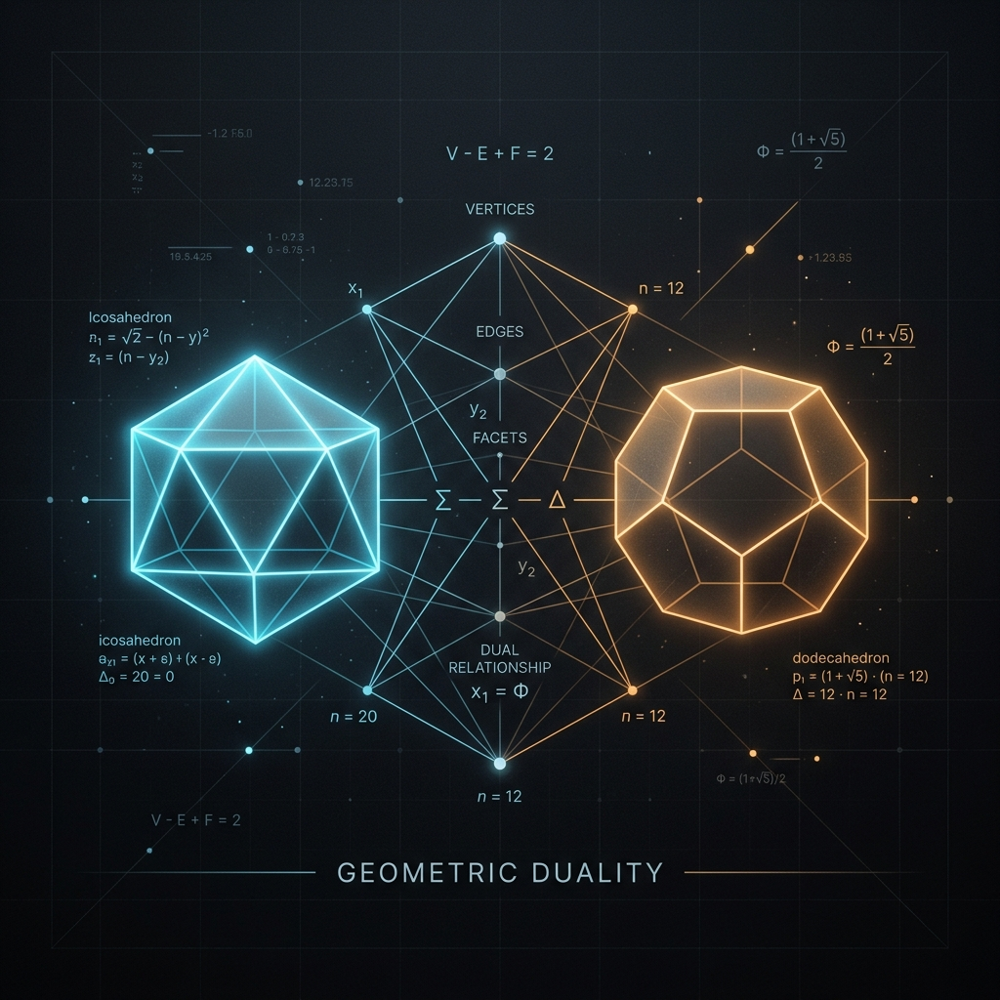

From Plato’s *Timaeus*, where geometric shapes were assigned to the classical elements, to modern computational physics, polyhedra represent the universe's inherent drive toward symmetry and energy minimization. According to Euler's topological invariant, for any convex polyhedron, the number of vertices ($V$), edges ($E$), and faces ($F$) strictly obeys $V - E + F = 2$.

By walking up the hierarchy of faces—from the 4-faced tetrahedron to the 20-faced icosahedron—we can observe how pure geometric forms dictate the behavior of molecules, the structure of viruses, and the cutting-edge of artificial intelligence.

---

## The Hierarchy of Faces (4 to 20)

### The Tetrahedron (4 Faces)
The simplest possible volume in three-dimensional space, the tetrahedron, consists of four triangular faces. 

* **Chemistry & Quantum Mechanics:** The tetrahedron is the bedrock of organic chemistry. Carbon atoms form $sp^3$ hybridized orbitals that naturally repel one another, settling into a tetrahedral geometry (bond angle 109.5°). This shape minimizes electron repulsion, giving rise to molecules like methane (CH₄) and the rigid 3D lattice of diamonds.
* **Computer Graphics & Simulation:** In Finite Element Analysis (FEA) and 3D rendering, complex volumes are "meshed" using tetrahedrons (e.g., Delaunay tetrahedralization). Because a tetrahedron is a 3D simplex, it represents the most computationally efficient way to interpolate spatial data.

### The Hexahedron / Cube (6 Faces)
* **Crystallography:** The cube is nature's preferred space-filling shape. In solid-state physics, the Simple Cubic (SC), Body-Centered Cubic (BCC), and Face-Centered Cubic (FCC) Bravais lattices define the atomic arrangement of most metals (like iron, copper, and gold).
* **Computer Science:** Voxel grids (3D pixels) inherently rely on hexahedral geometry. 3D array data structures in memory are isomorphic to Cartesian hexahedral grids, making them the standard for medical imaging (MRI/CT scans) and fluid dynamics simulations.

### The Octahedron (8 Faces)
The dual of the cube, the octahedron is formed by eight equilateral triangles.
* **Inorganic Chemistry:** Transition metal complexes frequently adopt octahedral coordination geometries. A central metal atom is surrounded by six ligands, a structure that dictates the magnetic and optical properties of the material (Crystal Field Theory).
* **Machine Learning & Optimization:** In high-dimensional spaces, the "unit ball" of the $L_1$-norm (Manhattan distance) is an orthoplex—an octahedron in 3D. This geometry is why $L_1$ regularization (Lasso regression) induces sparsity in neural networks and statistical models; the sharp vertices of the octahedron naturally intersect optimization planes at the axes, driving weights exactly to zero.

### The Dodecahedron (12 Faces)
Composed of twelve regular pentagons, the dodecahedron holds a mystical place in geometry.
* **Cosmology:** In 2003, analyzing the cosmic microwave background (CMB) data from the WMAP satellite, cosmologists proposed the *Poincaré Dodecahedral Space* as a candidate for the shape of the universe. This model suggested a finite, multiply-connected universe formed by identifying the opposite faces of a spherical dodecahedron.
* **Materials Science:** The discovery of quasicrystals—materials with ordered but strictly non-periodic structures—revealed dodecahedral and icosahedral diffraction symmetries, defying the classical laws of crystallography and earning Dan Shechtman the Nobel Prize.

### The Icosahedron (20 Faces)
The most complex of the Platonic solids, the icosahedron maximizes volume while minimizing surface area for shapes constructed of straight lines.
* **Virology (Caspar-Klug Theory):** Why are almost all spherical viruses (like Herpes, Adenovirus, and HPV) icosahedral? Viruses must pack their genetic material using the smallest possible genome. By coding for a single asymmetric protein subunit that self-assembles into an icosahedral capsid, the virus achieves maximum internal volume with minimal genetic overhead. 
* **Architecture:** Buckminster Fuller’s geodesic domes are spherical projections of the icosahedron, leveraging its network of triangles to distribute structural stress perfectly.

---

## The Deep Symmetry: Group Theory
In abstract algebra, the symmetries of polyhedra are described by finite groups, which hold profound implications for mathematics.

* **Tetrahedral Group ($T_d$):** Isomorphic to the symmetric group $S_4$ (order 24).
* **Octahedral Group ($O_h$):** The symmetry group of both the cube and the octahedron, order 48.
* **Icosahedral Group ($I_h$):** The symmetries of the icosahedron and dodecahedron form a group of order 120. Its rotation subgroup is isomorphic to the alternating group $A_5$ (order 60). 

Crucially, $A_5$ is the smallest non-abelian simple group. In Galois Theory, the fact that $A_5$ is not solvable is the exact reason why there is no general algebraic formula for the roots of a quintic (5th degree) polynomial. Felix Klein famously connected the geometry of the icosahedron directly to the solution of the quintic equation in his 1884 masterpiece, *Lectures on the Icosahedron*.

---

## Artificial Intelligence: Icosahedral CNNs
One of the most exciting modern applications of the icosahedron lies in **Geometric Deep Learning**.

Standard Convolutional Neural Networks (CNNs) process flat, 2D planar images. However, when AI is tasked with analyzing spherical data—such as 360° omnidirectional cameras, global weather forecasting models, or molecular surfaces—projecting this data onto a flat grid introduces massive polar distortions (the "Greenland problem" in Mercator projections).

To solve this, researchers introduced **Icosahedral CNNs** and Gauge Equivariant Convolutional Networks. By projecting the spherical data onto a subdivided icosahedron, the neural network can perform convolutions over a nearly uniform grid of triangles. Because the icosahedron has highly regular symmetries, these networks achieve exact **rotational equivariance** ($SO(3)$ symmetry). If a climate pattern or molecular shape rotates in 3D space, the neural network's feature maps rotate precisely with it, drastically improving the model's accuracy and sample efficiency without requiring augmented training data.

---

### Conclusion
The study of polyhedra is far from a historical curiosity. As we continue to probe the limits of molecular biology, abstract algebra, and artificial intelligence, we find that nature and mathematics have already solved our most complex optimization problems using the simple, elegant symmetries of these ancient forms.

---

### See Also
* [Polyhedra.net: Polyhedra ordered by number of faces](https://www.polyhedra.net/en/index-n-faces-polyhedron.php) - An exhaustive visual catalog of polyhedra geometries.

  
<footer>
© 2026 Igor Kan
</footer>
